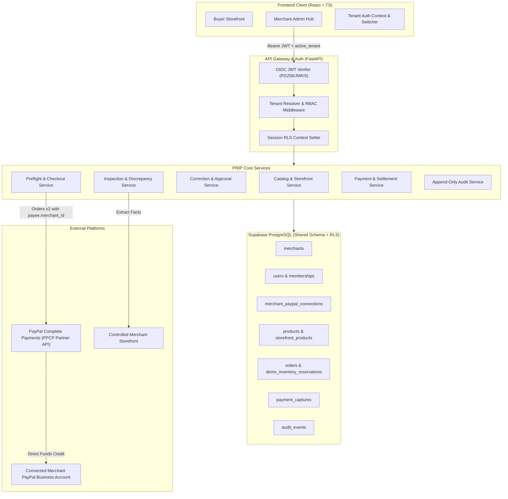
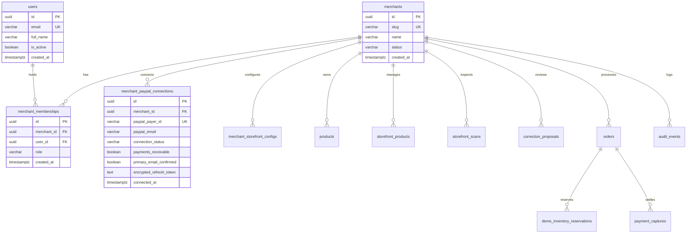
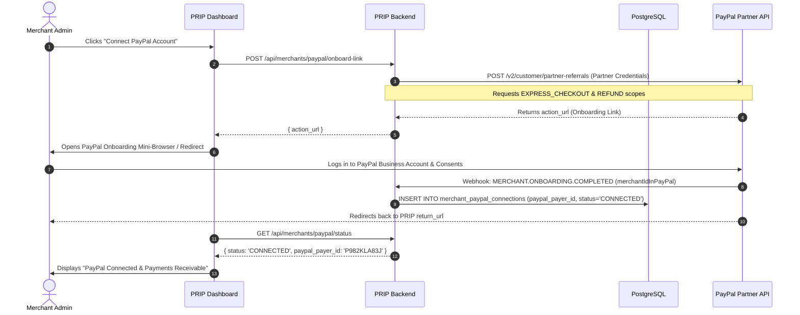
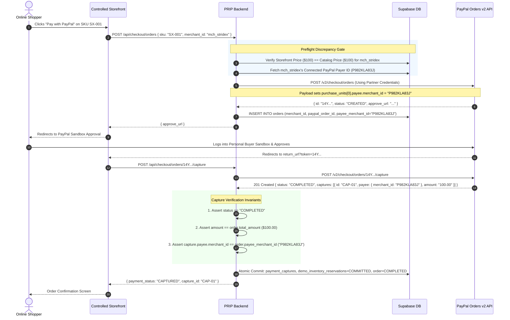
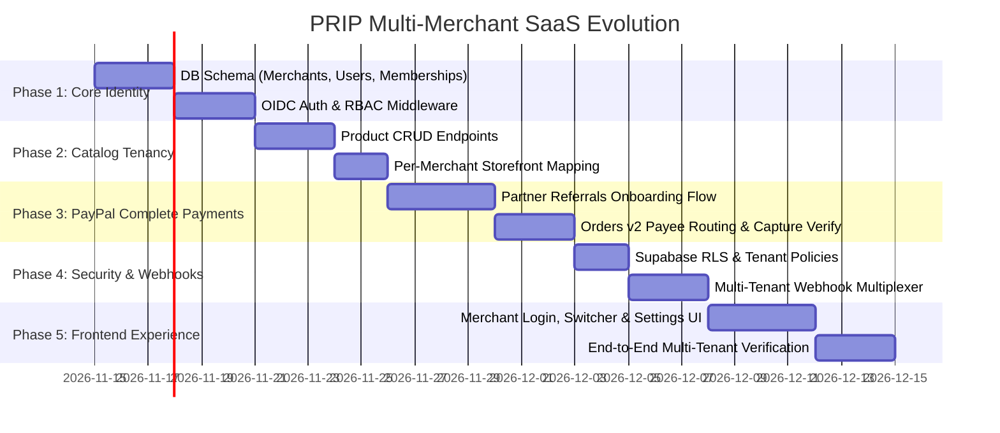

# PRIP Multi-Merchant Architecture & Migration Blueprint

> **Product Tagline:** Detect the discrepancy. Approve the correction. Verify the checkout.  
> **Document Status:** Architectural Proposal & Feasibility Gate (Phase 0 Planning)  
> **Target Environment:** Multi-Tenant SaaS Platform (FastAPI + React/TS + Supabase PostgreSQL + PayPal Complete Payments Partner Platform)

---

## Executive Summary

PRIP is evolving from a single-merchant commerce-integrity vertical slice into a production-grade multi-tenant SaaS platform. In this target architecture:
1. Independent merchants register, manage staff with granular Role-Based Access Control (RBAC), and configure their individual product catalogs and storefront endpoints.
2. Each merchant connects their own PayPal Business account via the **PayPal Complete Payments (PPCP) for Marketplaces & Platforms Partner Referrals API**.
3. When shoppers check out, PRIP's deterministic preflight discrepancy gate verifies catalog-to-storefront price parity, creates a PayPal Orders v2 order with `purchase_units[0].payee.merchant_id` bound to the specific merchant, and captures funds directly into that merchant's PayPal account.
4. Tenant isolation is enforced through defense-in-depth: JWT-derived authenticated membership context, tenant-scoped repositories, database foreign-key constraints, and Supabase Row-Level Security (RLS).

---

## 1. Current-State Architecture & Repository Audit

A comprehensive code and schema audit was performed on the existing codebase (commit `018d8d92f03a98710d1f34d87e8db1c8824b6b49`, Migration `012`).

| # | Inspection Domain | Implementation & Code Location | DB Objects & Columns | Current Status | Architectural Finding |
|---|---|---|---|---|---|
| **1** | **Authentication & User Identity** | [`backend/core/security.py#L231-L474`](file:///c:/Users/HP/OneDrive/Desktop/paypal/backend/core/security.py#L231-L474) | Token claims (`sub`, `email`, `role`) | **PARTIALLY IMPLEMENTED** | Asymmetric OIDC JWT validation (RS256/ES256 with dynamic JWKS discovery) is production-grade. However, all verified Google emails map to a single static `default_merchant_id` (`merchant_default`). No local `users` or `merchants` table exists. |
| **2** | **Tenant Columns & Indexes** | Migration [`012_unique_completed_capture_per_order.py`](file:///c:/Users/HP/OneDrive/Desktop/paypal/backend/migrations/versions/012_unique_completed_capture_per_order.py) & earlier | `products.merchant_id`<br>`orders.merchant_id`<br>`payment_captures.merchant_id`<br>`storefront_scans.merchant_id`<br>`correction_proposals.merchant_id`<br>`audit_events.merchant_id` | **IMPLEMENTED (Foundation only)** | All 10 domain tables have `merchant_id VARCHAR(100) NOT NULL DEFAULT 'merchant_default'` with indexes (e.g. `ix_orders_merchant_id`). However, `merchant_id` is an unconstrained string with no parent foreign key. |
| **3** | **Tenant Propagation** | Repositories in [`backend/repositories/`](file:///c:/Users/HP/OneDrive/Desktop/paypal/backend/repositories/) & API routes | `OrderRepository.list_orders(merchant_id=...)`<br>`ProductRepository.get_by_sku(merchant_id=...)` | **IMPLEMENTED** | Repositories accept `merchant_id` filter. `require_merchant_access()` enforces tenant barriers on detail/action routes. |
| **4** | **Supabase RLS Policies** | None | None | **MISSING** | No `CREATE POLICY` or `ENABLE ROW LEVEL SECURITY` statements exist in migrations. Database engine relies entirely on application-layer filtering. |
| **5** | **Catalog & Storefront Ownership** | [`backend/models/product.py`](file:///c:/Users/HP/OneDrive/Desktop/paypal/backend/models/product.py)<br>[`backend/models/storefront.py`](file:///c:/Users/HP/OneDrive/Desktop/paypal/backend/models/storefront.py) | `products.merchant_id`<br>`storefront_products.merchant_id` | **PARTIALLY IMPLEMENTED** | Data models support `merchant_id`. However, there are no endpoints to create custom products (`POST /api/products` missing), and storefront URL is a single global environment variable. |
| **6** | **Order, Reservation & Capture Linkage** | [`backend/models/order.py`](file:///c:/Users/HP/OneDrive/Desktop/paypal/backend/models/order.py)<br>[`backend/models/payment_capture.py`](file:///c:/Users/HP/OneDrive/Desktop/paypal/backend/models/payment_capture.py)<br>[`backend/models/reservation.py`](file:///c:/Users/HP/OneDrive/Desktop/paypal/backend/models/reservation.py) | Foreign keys: `order_id` references `orders.id`<br>Partial index: `ix_one_completed_capture_per_order` | **IMPLEMENTED** | Relational cascade and 1-to-1 completed capture constraint ensure strict integrity across checkout lifecycle. |
| **7** | **PayPal REST Credential Loading** | [`backend/core/config.py#L47-L58`](file:///c:/Users/HP/OneDrive/Desktop/paypal/backend/core/config.py#L47-L58)<br>[`backend/integrations/paypal/client.py#L29-L45`](file:///c:/Users/HP/OneDrive/Desktop/paypal/backend/integrations/paypal/client.py#L29-L45) | Environment variables: `PAYPAL_CLIENT_ID`, `PAYPAL_CLIENT_SECRET` | **SINGLE-TENANT ONLY** | Process-level credentials load once at startup. There is no credential storage or per-tenant client factory. |
| **8** | **Payee Routing in Orders v2** | [`backend/integrations/paypal/client.py#L103-L115`](file:///c:/Users/HP/OneDrive/Desktop/paypal/backend/integrations/paypal/client.py#L103-L115) | N/A | **NOT CONFIGURED** | Payload omits `purchase_units[].payee`. PayPal Orders v2 defaults routing to the global REST app credentials owner (`APP-2PA34687ND667320D`). |
| **9** | **PayPal Seller Onboarding** | None | None | **MISSING** | No partner referrals, OAuth redirect flow, or merchant connection screens exist. |
| **10** | **Capture Verification** | [`backend/services/payment.py#L289-L330`](file:///c:/Users/HP/OneDrive/Desktop/paypal/backend/services/payment.py#L289-L330) | `payment_captures.status`<br>`payment_captures.amount`<br>`payment_captures.fee_amount` | **PARTIALLY IMPLEMENTED** | Capture status `COMPLETED` is verified. However, explicit post-capture `assert amount == expected` and `assert payee.merchant_id == expected_seller` checks are absent. |
| **11** | **Webhook Processing & Idempotency** | [`backend/services/webhook.py#L50-L115`](file:///c:/Users/HP/OneDrive/Desktop/paypal/backend/services/webhook.py#L50-L115)<br>[`backend/services/webhook_worker.py#L115-L116`](file:///c:/Users/HP/OneDrive/Desktop/paypal/backend/services/webhook_worker.py#L115-L116) | `webhook_events.paypal_event_id` (UNIQUE)<br>`webhook_events.merchant_id` | **IMPLEMENTED** | Verifies PayPal's 5 transmission headers via official PayPal signature API. Deduplicates on `paypal_event_id`. Resolves tenant via order correlation. |
| **12** | **Frontend Tenant Filtering** | [`frontend/src/services/api.ts`](file:///c:/Users/HP/OneDrive/Desktop/paypal/frontend/src/services/api.ts) | N/A | **MISSING** | Frontend makes unauthenticated API requests without Authorization headers or tenant context. |
| **13** | **Legacy Single-Merchant Model** | All tables | Default tenant string `'merchant_default'` | **MIGRATION READY** | The baseline database has all single-tenant demo records pinned to `merchant_default`. A migration can map this directly to Tenant #1. |

---

## 2. Proposed Target Architecture



---

## 3. Database Schema Design (PostgreSQL / Supabase)

### 3.1 Entity Relationship Diagram



### 3.2 SQL DDL Schema Migration Plan

```sql
-- 1. Enable UUID extension
CREATE EXTENSION IF NOT EXISTS "uuid-ossp";

-- 2. Core Tenant Tables
CREATE TABLE merchants (
    id UUID PRIMARY KEY DEFAULT uuid_generate_v4(),
    slug VARCHAR(100) UNIQUE NOT NULL,
    name VARCHAR(200) NOT NULL,
    status VARCHAR(50) NOT NULL DEFAULT 'ACTIVE', -- ACTIVE, SUSPENDED, ONBOARDING
    created_at TIMESTAMPTZ NOT NULL DEFAULT NOW(),
    updated_at TIMESTAMPTZ NOT NULL DEFAULT NOW()
);

CREATE TABLE users (
    id UUID PRIMARY KEY DEFAULT uuid_generate_v4(),
    email VARCHAR(255) UNIQUE NOT NULL,
    full_name VARCHAR(200),
    is_active BOOLEAN NOT NULL DEFAULT TRUE,
    created_at TIMESTAMPTZ NOT NULL DEFAULT NOW(),
    updated_at TIMESTAMPTZ NOT NULL DEFAULT NOW()
);

CREATE TABLE merchant_memberships (
    id UUID PRIMARY KEY DEFAULT uuid_generate_v4(),
    merchant_id UUID NOT NULL REFERENCES merchants(id) ON DELETE CASCADE,
    user_id UUID NOT NULL REFERENCES users(id) ON DELETE CASCADE,
    role VARCHAR(50) NOT NULL, -- OWNER, ADMIN, MANAGER, VIEWER
    created_at TIMESTAMPTZ NOT NULL DEFAULT NOW(),
    updated_at TIMESTAMPTZ NOT NULL DEFAULT NOW(),
    CONSTRAINT uq_membership UNIQUE (merchant_id, user_id)
);

CREATE INDEX ix_memberships_user ON merchant_memberships(user_id);
CREATE INDEX ix_memberships_merchant ON merchant_memberships(merchant_id);

-- 3. PayPal Connected Accounts Table
CREATE TABLE merchant_paypal_connections (
    id UUID PRIMARY KEY DEFAULT uuid_generate_v4(),
    merchant_id UUID NOT NULL REFERENCES merchants(id) ON DELETE CASCADE,
    paypal_payer_id VARCHAR(100) NOT NULL, -- The seller's PayPal Merchant Payer ID
    paypal_email VARCHAR(255),
    connection_status VARCHAR(50) NOT NULL DEFAULT 'PENDING_ONBOARDING', -- PENDING, CONNECTED, REVOKED
    payments_receivable BOOLEAN NOT NULL DEFAULT FALSE,
    primary_email_confirmed BOOLEAN NOT NULL DEFAULT FALSE,
    encrypted_refresh_token TEXT, -- Optional encrypted token if custom partner auth used
    partner_referral_id VARCHAR(100),
    connected_at TIMESTAMPTZ,
    created_at TIMESTAMPTZ NOT NULL DEFAULT NOW(),
    updated_at TIMESTAMPTZ NOT NULL DEFAULT NOW(),
    CONSTRAINT uq_merchant_paypal UNIQUE (merchant_id),
    CONSTRAINT uq_paypal_payer_id UNIQUE (paypal_payer_id)
);

CREATE INDEX ix_pp_conn_payer ON merchant_paypal_connections(paypal_payer_id);

-- 4. Storefront Config Table
CREATE TABLE merchant_storefront_configs (
    id UUID PRIMARY KEY DEFAULT uuid_generate_v4(),
    merchant_id UUID NOT NULL REFERENCES merchants(id) ON DELETE CASCADE,
    storefront_url VARCHAR(255) NOT NULL,
    is_active BOOLEAN NOT NULL DEFAULT TRUE,
    created_at TIMESTAMPTZ NOT NULL DEFAULT NOW(),
    CONSTRAINT uq_merchant_storefront UNIQUE (merchant_id)
);

-- 5. Foreign Key Enforcement on Existing Tables
-- (Migrates merchant_id string to UUID foreign keys during phased cutover)
ALTER TABLE products 
    ADD COLUMN merchant_uuid UUID REFERENCES merchants(id) ON DELETE RESTRICT;

ALTER TABLE storefront_products 
    ADD COLUMN merchant_uuid UUID REFERENCES merchants(id) ON DELETE RESTRICT;

ALTER TABLE orders 
    ADD COLUMN merchant_uuid UUID REFERENCES merchants(id) ON DELETE RESTRICT,
    ADD COLUMN payee_merchant_id VARCHAR(100); -- Verifiable seller PayPal Payer ID

ALTER TABLE payment_captures 
    ADD COLUMN merchant_uuid UUID REFERENCES merchants(id) ON DELETE RESTRICT,
    ADD COLUMN payee_merchant_id VARCHAR(100),
    ADD COLUMN seller_receivable_gross NUMERIC(10, 2),
    ADD COLUMN platform_fee_amount NUMERIC(10, 2);

-- 6. Supabase Row-Level Security (RLS) Setup
ALTER TABLE products ENABLE ROW LEVEL SECURITY;
ALTER TABLE orders ENABLE ROW LEVEL SECURITY;
ALTER TABLE payment_captures ENABLE ROW LEVEL SECURITY;
ALTER TABLE correction_proposals ENABLE ROW LEVEL SECURITY;
ALTER TABLE audit_events ENABLE ROW LEVEL SECURITY;

-- Dynamic RLS Policy using PostgreSQL session variable
CREATE POLICY tenant_isolation_products ON products
    FOR ALL
    USING (merchant_id = current_setting('app.current_merchant_id', true));

CREATE POLICY tenant_isolation_orders ON orders
    FOR ALL
    USING (merchant_id = current_setting('app.current_merchant_id', true));

CREATE POLICY tenant_isolation_captures ON payment_captures
    FOR ALL
    USING (merchant_id = current_setting('app.current_merchant_id', true));
```

---

## 4. Authentication, Membership & RBAC Design

### 4.1 Role-Based Permissions Matrix

| Capability / Action | OWNER | ADMIN | MANAGER | VIEWER | Public Buyer |
| :--- | :---: | :---: | :---: | :---: | :---: |
| **Manage Merchant Profile** | Yes | Yes | Read | Read | No |
| **Manage Members & Roles** | Yes | Yes (Non-Owners) | No | No | No |
| **Connect / Disconnect PayPal** | Yes | No | No | No | No |
| **Create / Update Product Catalog** | Yes | Yes | Yes | No | No |
| **Trigger Storefront Scans** | Yes | Yes | Yes | No | No |
| **Approve / Reject Proposals** | Yes | Yes | Yes | No | No |
| **Execute Storefront Corrections** | Yes | Yes | No | No | No |
| **View Orders, Captures & Revenue** | Yes | Yes | Yes | Yes | No |
| **View Audit Trail** | Yes | Yes | Yes | Yes | No |
| **Checkout Preflight & Purchase** | N/A | N/A | N/A | N/A | **Yes (Public)** |

### 4.2 Multi-Tenant JWT Token Structure

```json
{
  "sub": "usr_78a1bc92-34ef-4b2a-89a1",
  "email": "operator@stridex.com",
  "iss": "https://accounts.google.com",
  "aud": "prip-api",
  "exp": 1794500000,
  "user_id": "usr_78a1bc92-34ef-4b2a-89a1",
  "merchants": [
    { "id": "mch_110e8400-e29b-11d4-a716", "slug": "stridex", "role": "OWNER" },
    { "id": "mch_220e8400-e29b-11d4-a716", "slug": "apex-apparel", "role": "VIEWER" }
  ],
  "active_merchant_id": "mch_110e8400-e29b-11d4-a716",
  "active_role": "OWNER"
}
```

### 4.3 Tenant Resolution Pipeline

1. **Token Extraction:** Fast-path reads Bearer JWT from `Authorization: Bearer <token>`.
2. **Cryptographic Validation:** Asymmetric RS256 validation against trusted Google JWKS.
3. **Tenant Membership Check:** The backend queries `merchant_memberships` for `(user_id, active_merchant_id)`.
   - **Crucial Rule:** The server *never* trusts a client-supplied `X-Merchant-ID` header unless the authenticated user holds an active membership for that tenant.
4. **Session Context Injection:**
   - Injects `AuthenticatedActor(actor_id=user_id, merchant_id=active_merchant_id, role=active_role)`.
   - Executes `SET LOCAL app.current_merchant_id = :merchant_id` on the database session for RLS.

---

## 5. PayPal Complete Payments (PPCP) Feasibility & Integration

### 5.1 Architecture Decision Gate: Direct API vs. Partner Model

| Evaluation Dimension | Option A: Individual REST Credentials per Merchant | Option B: PayPal Complete Payments (PPCP) Partner Platform |
| :--- | :--- | :--- |
| **How it Works** | Every merchant registers their own app in PayPal Developer Portal, copies `client_id` and `client_secret`, and pastes into PRIP. | PRIP registers **one master Partner Platform App**. Merchants onboard with a 1-click "Connect with PayPal" OAuth flow. |
| **Security & Key Management** | **Severe Risk:** PRIP must securely store and rotate dozens of raw client secrets in a vault. High breach liability. | **Minimal Risk:** PRIP never touches or stores raw merchant client secrets or bank details. Handled via PayPal Payer ID. |
| **Buyer Checkout Experience** | Fragmented; each merchant uses disjointed apps. | Unified, branded checkout with seamless checkout flows. |
| **Payee Routing** | Each tenant executes orders against a separate client instance. | Single master client issues Orders v2 with `purchase_units[0].payee.merchant_id = seller_payer_id`. |
| **Webhooks** | PRIP must register and maintain individual webhooks for every merchant. | Single platform webhook endpoint receives events across all connected sellers. |
| **Platform Revenue / Fees** | Cannot collect integrated platform transaction fees. | Supports automatic platform revenue sharing (`payment_instruction.platform_fees`). |
| **Feasibility Verdict** | **REJECTED** (High operational fragility, high security risk). | **SELECTED ARCHITECTURE** (Standard enterprise marketplace standard). |

### 5.2 Seller Onboarding Flow (Partner Referrals API)



---

## 6. Checkout, Capture & Webhook Sequence (Multi-Merchant Payee Routing)



---

## 7. Tenant Isolation & Threat Model

### 7.1 Defense-in-Depth Layering

```
[Layer 1: Edge / Transport]
  Strict HTTPS, CORS origin allowlist (no wildcards), rate-limiting per IP/token.
       │
[Layer 2: Token & Identity]
  RS256 OIDC signature check; decode user_id; reject unverified emails.
       │
[Layer 3: Membership Authorization]
  Query merchant_memberships(user_id, merchant_id); verify active role permissions.
       │
[Layer 4: Repository Tenancy Enforcement]
  All queries force WHERE merchant_id = :active_merchant_id.
       │
[Layer 5: Database Row-Level Security (RLS)]
  PostgreSQL enforces current_setting('app.current_merchant_id') on table engine.
       │
[Layer 6: Universal Append-Only Audit Logging]
  Every state-mutating action logs (merchant_id, actor_id, before_state, after_state).
```

### 7.2 Threat Model & Mitigations

| Threat Vector | Attack Description | Architectural Mitigation |
| :--- | :--- | :--- |
| **T1: Tenant Header Spoofing** | Attacker injects `X-Merchant-ID: victim_tenant` in HTTP request. | **Fails Closed:** `get_current_actor()` validates membership against database. Header values not backed by DB membership return HTTP 403. |
| **T2: Payee Routing Hijacking** | Malicious actor modifies checkout payload to divert payout to attacker's PayPal account. | **Strict Server Resolution:** Storefront payload passes SKU only. Backend looks up payee PayPal ID directly from `merchant_paypal_connections` table. |
| **T3: Cross-Tenant Data Leak via ORM Bug** | Developer omits `.where(merchant_id=...)` in a query. | **Supabase RLS Engine:** PostgreSQL rejects rows where `merchant_id != current_setting('app.current_merchant_id')`. |
| **T4: Webhook Replay / Injection** | Attacker replays genuine webhook or crafts fake payload to force mark order as paid. | **Cryptographic Verification + Deduplication:** All 5 transmission headers checked via PayPal signature API; duplicate `paypal_event_id` safely discarded. |
| **T5: Payee Mismatch on Capture** | A compromised or misconfigured PayPal order settles to an unintended merchant. | **Capture Invariant Check:** Backend explicitly verifies `capture.payee.merchant_id == order.payee_merchant_id` before committing inventory or marking paid. |

---

## 8. Legacy Single-Merchant Migration & Rollback Strategy

### 8.1 Migration Cutover Steps
1. **Migration 013 (Schema Creation):** Creates `merchants`, `users`, `merchant_memberships`, `merchant_paypal_connections`.
2. **Migration 014 (Data Seeding & Backfill):**
   ```sql
   -- Create default legacy merchant record
   INSERT INTO merchants (id, slug, name, status)
   VALUES ('a0000000-0000-0000-0000-000000000001', 'stridex-legacy', 'StrideX Flagship Store', 'ACTIVE');

   -- Link existing 'merchant_default' rows to legacy merchant UUID
   UPDATE products SET merchant_uuid = 'a0000000-0000-0000-0000-000000000001' WHERE merchant_id = 'merchant_default';
   UPDATE storefront_products SET merchant_uuid = 'a0000000-0000-0000-0000-000000000001' WHERE merchant_id = 'merchant_default';
   UPDATE orders SET merchant_uuid = 'a0000000-0000-0000-0000-000000000001' WHERE merchant_id = 'merchant_default';
   UPDATE payment_captures SET merchant_uuid = 'a0000000-0000-0000-0000-000000000001' WHERE merchant_id = 'merchant_default';
   ```
3. **Migration 015 (Constraints & RLS Activation):** Applies NOT NULL constraints on `merchant_uuid` and activates Supabase RLS policies.
4. **Zero-Downtime Compatibility:** Repositories fall back to `merchant_uuid` if `merchant_id` is supplied, preserving backwards compatibility during code deployment.

### 8.2 Rollback Plan
- Each Alembic migration script defines an explicit `downgrade()` function:
  - Disables RLS policies.
  - Drops foreign-key constraints.
  - Retains original `merchant_id` VARCHAR columns intact so rollback never destroys historical single-tenant data.

---

## 9. Phased Implementation Roadmap



### Acceptance Criteria per Phase:
- **Phase 1:** Merchant A admin and Merchant B admin authenticate; neither can read or mutate the other's user list.
- **Phase 2:** Merchant A creates SKU `SX-001`; Merchant B creates SKU `SX-001` with different pricing without namespace conflict.
- **Phase 3:** Orders created for Merchant A route funds to Merchant A's PayPal Payer ID; Orders for Merchant B route funds to Merchant B.
- **Phase 4:** Direct SQL query without `app.current_merchant_id` returns 0 rows due to RLS; capture fails if PayPal returns unexpected payee ID.
- **Phase 5:** Full end-to-end purchase on Merchant A verifies in Merchant A's UI; Merchant B dashboard shows zero orders.

---

## 10. Multi-Tenant Test Strategy

A dedicated test suite (`backend/tests/test_multi_tenant_saas.py`) will enforce:
1. **Cross-Tenant Mutation Attack:** Merchant A operator attempts `POST /api/corrections/proposals/{id}/approve` on Merchant B's proposal → Expect HTTP 403 Forbidden.
2. **Tenant ID Spoofing Attack:** Authenticated Merchant A passes `X-Merchant-ID: merchant_b` → Expect HTTP 403 Forbidden.
3. **Payee Tampering Attack:** Checkout payload specifies Merchant A's SKU but injects Merchant B's payee → Backend rejects with `ValueError: Payee mismatch`.
4. **Capture Payee Mismatch Simulation:** Mock PayPal returns capture response where `payee.merchant_id != expected` → Status transitions to `FAILED`, inventory remains uncommitted, audit alert logged.
5. **Duplicate Webhook Delivery:** Identical PayPal webhook received 5 times concurrently → Exactly 1 state transition, 4 `WEBHOOK_DUPLICATE_IGNORED` events.
6. **RLS Engine Bypass Check:** Direct raw SQL executed with tenant A context attempting to select tenant B rows returns 0 records.

---

## 11. Open Questions Requiring Business / PayPal Confirmation

> [!IMPORTANT]
> The following items require stakeholder or external partner confirmation before implementation begins:

1. **PayPal Partner Vetting & Approval:**
   - *Question:* Does the business entity have an approved **PayPal Partner contract** enabling the PayPal Complete Payments (PPCP) for Marketplaces and Platforms product?
   - *Impact:* Sandbox development can use partner mock apps immediately, but live deployment requires formal PayPal underwriting and partner onboarding approval.
2. **Platform Fee Structure:**
   - *Question:* Will PRIP take an application platform fee on merchant checkouts (e.g. 1% platform fee via `payment_instruction.platform_fees`), or is it a pure SaaS subscription without transaction cut?
3. **Dispute & Refund Liability:**
   - *Question:* Under PPCP, is PRIP operating as **Marketplace with Shared Liability** or **Marketplace with Seller Liability** for chargebacks and customer disputes?
4. **Primary Identity Provider:**
   - *Question:* Will multi-tenant authentication continue using Google Workspace OIDC exclusively, or will merchants require email/password or Microsoft Entra ID integration?

---

## Prioritized Architecture Decision Record (ADR)

| ADR # | Decision Title | Decision | Status | Rationale |
|---|---|---|---|---|
| **ADR-001** | Multi-Tenancy Isolation Strategy | **Shared Database, Shared Schema with RLS** | **APPROVED** | Lowest operational overhead; migration 012 already added `merchant_id` columns; Supabase PostgreSQL supports high-performance RLS. |
| **ADR-002** | PayPal Multi-Merchant Routing | **PayPal Complete Payments (PPCP) Partner Model** | **APPROVED** | Eliminates storage of raw merchant secrets; uses `purchase_units[0].payee.merchant_id` to route funds natively to seller's PayPal account. |
| **ADR-003** | Authorization & Tenancy Guard | **Database-Verified Membership Context (No Client Trust)** | **APPROVED** | Prevents header spoofing. JWT claims identify user; database membership binds user to active merchant tenant. |
| **ADR-004** | Payment Capture Invariant Check | **Mandatory Triple Check (Status, Amount, Payee)** | **APPROVED** | Prevents misrouted capture settlements. Capture commits inventory only when `status=COMPLETED`, `amount=expected`, and `payee_merchant_id=expected`. |

---
*Planning and audit complete. No application code, database schema, or PayPal credentials were modified.*
