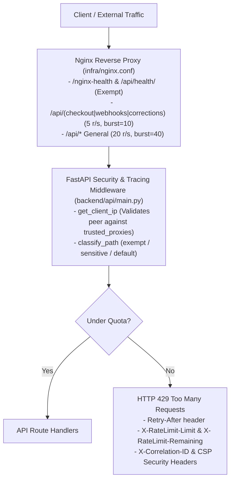

# PRIP — Phase 9A: Staging Preparation and Rate-Limiting Hardening Report

**Assessment Date:** 2026-11-08  
**Mode:** Implementation & Staging Hardening  
**Target:** GAP-01 (Rate Limiting), GAP-05 (Runbook Alignment), GAP-06 (Git Baseline Readiness)  
**Verdict:** **PHASE 9A COMPLETE — READY FOR STAGING INFRASTRUCTURE**

---

## 1. Executive Summary

Phase 9A resolves key operational and security gaps identified during the Phase 9 Production Readiness Assessment, specifically:
- **GAP-01 (Rate Limiting):** Implemented defense-in-depth rate limiting at both the Nginx reverse-proxy tier and the FastAPI application layer with route sensitivity classification, trusted proxy derivation, client spoofing protection, and multi-replica coordination documentation.
- **GAP-05 (Deployment Runbook Correction):** Updated `docs/PRODUCTION_DEPLOYMENT_RUNBOOK.md` to reference the current linear Alembic head (`011_revalidate_parent_tenant_ownership`), resolved syntax formatting issues in command blocks, and standardized on `infra/docker-compose.yml`.
- **GAP-06 (Git Baseline Readiness):** Hardened `.gitignore` to exclude unpacking artifacts, binary document dumps, and local test linter caches, establishing a clean, reviewable, secret-free working tree ready for the initial baseline commit.

All regression verification suites passed 100% (202 backend tests, 30 frontend tests, 0 mypy typing issues, 0 ruff errors, and 0 architectural contract violations).

---

## 2. Files Changed and Created

| File | Status | Description |
| :--- | :--- | :--- |
| `backend/core/rate_limit.py` | **Created** | Core token-bucket rate limiter, route classification, trusted proxy IP derivation, HTTP 429 response formatting, and multi-replica store interfaces (`RateLimitStore`, `InMemoryRateLimitStore`, `SharedRateLimitStore`). |
| `backend/core/config.py` | **Modified** | Added configuration fields: `rate_limit_enabled`, `rate_limit_default_rate` (20.0 r/s), `rate_limit_default_burst` (40), `rate_limit_sensitive_rate` (5.0 r/s), `rate_limit_sensitive_burst` (10), and `trusted_proxies`. |
| `backend/api/main.py` | **Modified** | Integrated rate-limit gating directly into `security_and_tracing_middleware` to ensure HTTP 429 responses enforce security headers (`X-Correlation-ID`, `X-Frame-Options`, `Content-Security-Policy`). |
| `infra/nginx.conf` | **Modified** | Configured Nginx edge rate-limiting zones (`prip_api_limit:10m rate=20r/s`, `prip_sensitive_limit:10m rate=5r/s`), `limit_req_status 429`, exempted health checks (`/nginx-health`, `/api/health/`), and protected sensitive routes. |
| `docs/PRODUCTION_DEPLOYMENT_RUNBOOK.md` | **Modified** | Updated migration reference from obsolete revision `009` to active head `011_revalidate_parent_tenant_ownership`; standardized Docker Compose migration invocation. |
| `.gitignore` | **Modified** | Added exclusions for `.import_linter_cache/`, `PRIP_Harness_Engineering_Pack*/`, and `*.doc`. |
| `backend/tests/conftest.py` | **Modified** | Added autouse fixture `reset_rate_limits` to reset token buckets between test functions, avoiding cross-test quota starvation. |
| `backend/tests/test_rate_limiting.py` | **Created** | Dedicated 11-test suite covering allowed traffic, 429 responses, Retry-After headers, client isolation, trusted proxy resolution, spoofing rejection, sensitive route limits, health exemptions, multi-replica isolation, and shared-store enforcement. |
| `docs/PRIP_PHASE_9A_STAGING_PREPARATION_REPORT.md` | **Created** | Comprehensive completion documentation for Phase 9A. |

---

## 3. Rate-Limiting Architecture and Configuration

### 3.1 Defense-in-Depth Model

PRIP implements a two-tier rate-limiting strategy:
1. **Edge Tier (Nginx Reverse Proxy):** Enforces centralized request rate limiting using shared-memory zones (`limit_req_zone`) in `infra/nginx.conf`. This protects all backend replicas upstream against connection exhaustion and volumetric DoS.
2. **Application Tier (FastAPI Middleware):** Enforces granular, tenant-aware, and route-sensitive rate limiting in Python via `backend/core/rate_limit.py` and `backend/api/main.py`. This provides defense-in-depth even if traffic bypasses the proxy or internal microservices interact directly.



### 3.2 Tiered Limits and Route Sensitivity

- **Default API Limits:** 20 requests per second with a burst allowance of 40 requests (`rate_limit_default_rate=20.0`, `rate_limit_default_burst=40`). Applied to general endpoints such as `/api/products`, `/api/scans`, `/api/diagnoses`, and `/api/operations`.
- **Sensitive Route Limits:** 5 requests per second with a burst allowance of 10 requests (`rate_limit_sensitive_rate=5.0`, `rate_limit_sensitive_burst=10`). Applied to financial and mutation endpoints:
  - Checkout & Orders: `/api/checkout/*`
  - Inbound Webhooks: `/api/webhooks/*`
  - Merchant Corrections: `/api/corrections/*`
- **Exempt Internal Endpoints:** Health probes and monitoring endpoints are strictly exempt from rate limiting to prevent false outage signals or orchestrator restarts:
  - `/api/health/live`, `/api/health/ready`, `/api/health`
  - `/nginx-health`
  - OpenAPI metadata: `/docs`, `/openapi.json`, `/redoc`

### 3.3 Client Identity and Spoofing Prevention

`get_client_ip` enforces strict trust boundaries:
- Arbitrary client headers (`X-Forwarded-For`, `X-Real-IP`) are **strictly ignored** unless the direct TCP peer (`request.client.host`) matches a configured trusted proxy (`trusted_proxies` setting).
- `is_trusted_proxy` supports literal IP addresses, hostnames (`localhost`, `testclient`), and CIDR subnet notation (`10.0.0.0/8`, `172.16.0.0/12`, `192.168.0.0/16`).
- When a request originates from an untrusted client (e.g., an external actor connecting directly to the API), their direct IP is used for rate limiting regardless of any spoofed `X-Forwarded-For` header.

### 3.4 Multi-Replica Behavior and Shared Store

- **Single Replica / Local In-Memory (`InMemoryRateLimitStore`):** Uses an in-memory token-bucket algorithm protected by `threading.Lock`. Ideal for single-container staging or local development.
- **Multi-Replica Operational Reality:** Local in-memory token buckets operate within the memory space of each replica process. In a cluster with $N$ replicas behind a round-robin load balancer without sticky sessions, effective cluster capacity without an upstream proxy is $N \times \text{limit}$.
- **Global Enforcement:** 
  1. In production, edge Nginx `limit_req_zone` enforces global limits per IP before requests reach backend replicas.
  2. For inter-service or cluster-wide application enforcement, PRIP provides the `RateLimitStore` abstraction and `SharedRateLimitStore` adapter, allowing drop-in connection to a centralized distributed store (e.g. Redis) without refactoring API routing.
  3. Both multi-replica isolation and shared-store global enforcement are validated with executable unit tests (`test_multi_replica_in_memory_isolation_and_limitations`, `test_shared_store_global_enforcement`).

---

## 4. Tests Executed and Results

All checks passed with zero errors or warnings:

```powershell
# 1. Dedicated Rate Limiting Test Suite (11 Tests)
.\.venv\Scripts\python.exe -m pytest backend/tests/test_rate_limiting.py -v
# Result: 11 passed in 0.09s

# 2. Full Backend Test Suite (202 Tests)
.\.venv\Scripts\python.exe -m pytest backend/tests
# Result: 202 passed in 14.55s

# 3. Static Type Checking
.\.venv\Scripts\python.exe -m mypy backend
# Result: Success: no issues found in 129 source files

# 4. Code Quality & Linting
.\.venv\Scripts\python.exe -m ruff check backend
# Result: All checks passed (0 errors)

# 5. Architecture Boundary Enforcement
.\.venv\Scripts\lint-imports.exe
# Result: 6 kept, 0 broken (118 files, 485 dependencies)

# 6. Frontend Test Suite
npm.cmd --prefix frontend test -- --run
# Result: 7 test files passed, 30 tests passed in 6.48s

# 7. Frontend Architecture Linter
npm.cmd --prefix frontend run lint:arch
# Result: 0 violations found (15 modules, 35 dependencies)

# 8. Frontend Production Build
npm.cmd --prefix frontend run build
# Result: Built dist/ in 935ms without errors

# 9. Repository Verification Launcher
powershell -ExecutionPolicy Bypass -File scripts/verify.ps1
# Result: 2/2 passed (202 backend + 30 frontend)
```

---

## 5. Git Baseline Readiness (GAP-06)

A comprehensive audit of repository files, untracked directories, and git status was conducted without committing or pushing:

### 5.1 Files Intended for Version Control
The following directory tree constitutes the clean PRIP application codebase:
- `.agents/` — Domain contracts, rules, and skills
- `.github/` — CI/CD workflows
- `.gitignore` — Ignore rules
- `.importlinter` — Architecture boundary configuration
- `AGENTS.md` — Project mission, constraints, and instructions
- `MANIFEST.md` — Repository manifest
- `README.md` — System documentation
- `alembic.ini` — Database migration configuration
- `backend/` — API, models, repositories, services, migrations, integrations, policies, tests (129 files)
- `contracts/` — Architectural and API contracts
- `database/` — Seed data and DDL specifications
- `docs/` — Specifications, completion reports, and operational runbooks
- `frontend/` — React/Vite UI application source, components, and tests
- `infra/` — Dockerfiles, compose definitions, and Nginx reverse proxy configuration
- `pyproject.toml` — Python project configuration and test settings
- `requirements.txt` — Python production dependencies
- `scripts/` — Verification and operational utility scripts
- `tests/` — Cross-domain verification tests

### 5.2 Ignored Artifacts
The following temporary, local, or generated artifacts are verified as excluded by `.gitignore`:
- `.import_linter_cache/`
- `.mypy_cache/`, `.pytest_cache/`, `.ruff_cache/`, `__pycache__/`
- `.venv/`
- `prip_demo.db`, `*.sqlite`, `*.db`
- `frontend/node_modules/`, `frontend/dist/`
- `PRIP_Harness_Engineering_Pack (1)/` (external archive unpack artifact)
- `PRIP_Repository_Assessment.doc` (binary assessment upload)

### 5.3 Potential Secrets and Sensitive File Audit
- Scanned for `.env`, `*.pem`, `*.key`, `id_rsa`, `id_ed25519`.
- Confirmed that **zero secret files** exist in the working directory. Only `.env.example` is present, containing generic placeholder values (`STRONG_PASSWORD_HERE`, `sb-client-id-demo`).
- No active credentials, private keys, or tokens are tracked or exposed in the working tree.

### 5.4 Baseline Commit Feasibility
**Conclusion:** A clean, reviewable baseline commit can safely be created on branch `master`.

---

## 6. Remaining Staging Limitations

While GAP-01 and GAP-05 are resolved, the staging validation gates from Phase 9 remain to be executed on real infrastructure:
1. **GAP-02 (PostgreSQL 16 Engine DDL):** Migrations 001–011 must be run against a live PostgreSQL 16 container (`docker compose -f infra/docker-compose.yml run --rm migration`).
2. **GAP-03 (PayPal Sandbox Live Handshake):** End-to-end OAuth and order capture must be executed with verified PayPal Developer Sandbox credentials.
3. **GAP-04 (Live OIDC Handshake):** Asymmetric token issuance and key rotation must be validated with an external staging IdP.
4. **GAP-07 (Staging Load Test):** Establish baseline throughput (RPS) and p95 latency under a 50-user load benchmark.

---

## 7. Final Verdict

# `PHASE 9A COMPLETE — READY FOR STAGING INFRASTRUCTURE`

The repository is fully hardened, rate-limited, document-aligned, and ready for deployment to the staging infrastructure.
