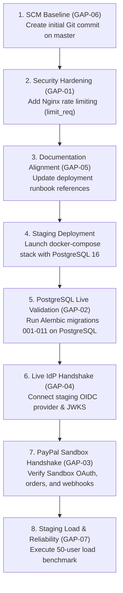

# PRIP — Phase 9: Production Readiness Assessment

**Assessment Date:** 2026-11-08  
**Mode:** READ-ONLY Assessment  
**Target:** Staging Deployment & Operational Readiness  
**Verdict:** **READY FOR STAGING VALIDATION**

---

## 1. Executive Summary

This assessment evaluates whether the PayPal Revenue Intelligence Platform (PRIP) is prepared for deployment to a production-like staging environment. 

All core Phase 1–8 capabilities, including human-approved remediation workflows, PayPal Sandbox payment and webhook integration, multi-merchant isolation, and the security remediations for migrations 009–011, are implemented and verified in unit and hermetic integration test suites. The code quality gates pass 100% (191 backend unit/integration tests, 30 frontend tests, 0 mypy typing issues, 0 ruff lint errors, and 0 architectural contract violations).

However, full production deployment cannot be certified based on local in-memory SQLite and mock fixtures alone. Key infrastructure dependencies—specifically live PostgreSQL 16 migrations and concurrent worker leasing, live OpenID Connect (OIDC) identity provider token verification, live PayPal Sandbox OAuth/webhook handshakes, and rate limiting—require verification in an isolated, production-like **staging environment**.

Therefore, the system is evaluated as **READY FOR STAGING VALIDATION**, with a prioritized gap register and go/no-go checklist defined below.

---

## 2. Security Baseline

### 2.1 Audit Baseline & Alembic Head
- **Alembic Revision Head:** The migration tree is verified at `011_revalidate_parent_tenant_ownership (head)`.
- **Revision History Integrity:**
  - `008_multi_merchant_and_production_hardening` -> `009_tenant_ownership_and_audit_attribution` -> `010_tenant_quarantine_and_audit_hardening` -> `011_revalidate_parent_tenant_ownership`.
  - The revision graph is strictly linear with no branching or unresolved heads.
- **Audit Attribution Fallback:** Confirmed eliminated. Both `AuditRepository.append` and `AuditService.log_event` fail closed with `ValueError` on omitted, empty, or whitespace-only `merchant_id`. The default `'merchant_default'` has been completely excised from audit logging pathways.
- **Tenant Isolation & Reserved Tenants:**
  - `RESERVED_SYSTEM_TENANTS = {"QUARANTINED_ORPHAN", "platform_system", "platform"}` is enforced across authentication (`get_current_actor`), authorization (`require_merchant_access`), repository filters, and audit access methods.
  - Queries explicitly requesting reserved tenant IDs return empty results to unprivileged callers. Setting privileged query flags (`include_system=True`, `allow_quarantined=True`) without platform administrative authorization (`superadmin`, `system_admin`) raises `PermissionError`.
- **BOLA Enforcement:** Object-level authorization guards (`require_merchant_access`) are verified across all API endpoints in checkout, corrections, diagnoses, operations, products, scans, and storefront domains.
- **Known Vulnerabilities:** Zero unresolved critical or high-severity vulnerabilities remain from independent audits.
- **Git Working-Tree State:**
  - Working tree is clean on branch `master`, currently containing untracked files from project setup with no commits yet recorded.
  - *Recovery Risk:* An initial commit must be tagged or committed prior to staging deployment so standard git recovery mechanisms (`git checkout`, `git reset`) operate safely.

---

## 3. PostgreSQL Readiness

### 3.1 Implemented Capabilities
- **Engine & Pooling Configuration (`backend/core/database.py`):**
  - Targets PostgreSQL 16 with connection pooling (`pool_size=10` default, configurable via `DATABASE_POOL_SIZE=20`), `max_overflow=20` (configurable to 40), `pool_timeout=30.0s`, `pool_pre_ping=True`, and `pool_recycle=1800s`.
  - In production (`APP_ENV=production`), engine initialization strictly fails closed with `RuntimeError` if PostgreSQL connection fails; fallback to SQLite is completely disabled.
- **Transaction Boundaries & Audit Atomicity:**
  - `atomic_transaction` context manager commits atomically on success and rolls back on unhandled exceptions.
  - State mutations and audit log insertions are atomic.
- **PostgreSQL Worker Concurrency Locking (`backend/repositories/webhook.py`):**
  - Implements `SELECT ... FOR UPDATE SKIP LOCKED` when `dialect.name == "postgresql"`, preventing worker lock contention or duplicate event claims.
  - Provides distributed leasing with `processing_lease_expires_at` and crash recovery.
- **Database Indexes:**
  - Composite and single-column indexes exist on all tenant foreign keys: `merchant_id` across `products`, `orders`, `storefront_scans`, `diagnoses`, `evidence_items`, `payment_captures`, `demo_inventory_reservations`, `webhook_events`, `payment_reconciliations`, and `audit_events`.

### 3.2 Executed vs. Unverified Status
| Area | Execution Status | Evidence / Location |
| :--- | :--- | :--- |
| **Engine Pool Kwargs & Fail-Closed** | **EXECUTED** | `test_production_hardening.py#test_15_production_fails_closed_without_sqlite_fallback` |
| **PostgreSQL Dialect Logic Branching** | **EXECUTED** | `test_operational_resilience.py#test_18_worker_concurrent_claim_skip_locked` |
| **Live PostgreSQL 16 DDL & Migration Run** | **UNVERIFIED** | All automated tests run on in-memory SQLite; PostgreSQL 16 migrations 001–011 have not run against a real PostgreSQL instance. |
| **Live `SKIP LOCKED` Multi-Worker Contention** | **UNVERIFIED** | Requires live PostgreSQL instance with multi-process workers. |
| **Connection Pool Exhaustion Under Load** | **UNVERIFIED** | Requires staging concurrent stress/load harness. |
| **Live Query Plan & Index Selectivity** | **UNVERIFIED** | Requires populated PostgreSQL database under representative volume. |

---

## 4. Identity and Access Management (IAM)

### 4.1 Implemented Capabilities
- **OIDC Token Verification (`backend/core/security.py`):**
  - Validates RFC 7519 JWT structure, signature, `exp`, `nbf`, `iss` (against `settings.oidc_issuer`), and `aud` (against `settings.oidc_client_id`).
  - Production mode requires claims `["exp", "sub", "iss", "aud"]` and explicit `merchant_id` claim.
- **Asymmetric Signature Verification:**
  - Production strictly mandates `RS256` or `ES256`. Symmetrical `HS256` and unsigned `none` algorithms are rejected with `HTTP 401`.
- **Dynamic JWKS Management (`JWKSManager`):**
  - Uses `PyJWKClient` with in-memory caching (`lifespan=3600s`, `max_cached_keys=16`, `cache_jwk_set=True`, `timeout=5.0s`, `cooldown_duration=10.0s`).
  - Validates `kid` header and enforces that JWKS authority matches issuer hostname (`parsed_jwks.netloc == parsed_issuer.netloc`) to prevent rogue JWKS spoofing.
- **Production Header Simulation Block:**
  - `get_current_actor` strictly rejects `X-Actor-ID`, `X-Actor-Role`, `X-Merchant-ID` headers with `HTTP 401` in production. Only genuine Bearer tokens are permitted.

### 4.2 Executed vs. Unverified Status
| Area | Execution Status | Evidence / Location |
| :--- | :--- | :--- |
| **RS256/ES256 Signature Verification** | **EXECUTED** | `test_production_hardening.py#test_01`–`test_05` (ephemeral RSA key pairs) |
| **Algorithm Restriction (none, HS256 block)** | **EXECUTED** | `test_production_hardening.py#test_02`, `test_03` |
| **Production Header Simulation Rejection** | **EXECUTED** | `test_production_hardening.py#test_06` |
| **Issuer & Audience Validation** | **EXECUTED** | `test_production_hardening.py#test_04`, `test_05` |
| **Live Identity Provider (IdP) Handshake** | **UNVERIFIED** | Tested with in-memory registered JWKS keys; live network retrieval against external IdP (Okta/Auth0/Keycloak) requires staging IdP. |
| **Token Revocation (CRL / Blacklist)** | **UNVERIFIED / GAP** | Stateless JWT expiry is enforced; mid-session token revocation is not implemented. |

---

## 5. PayPal Sandbox Readiness

### 5.1 Implemented Capabilities
- **Sandbox Adapter (`PayPalSandboxClient`):**
  - Restricted to sandbox domains (`"sandbox" in base_url.lower()`).
  - Implements OAuth2 `client_credentials` grant with token caching and 60s safety buffer.
  - Orders v2 integration: `create_order`, `get_order_details`, `capture_order`.
  - Supports `PayPal-Request-Id` idempotency headers on order creation and capture.
  - Parses receivable fee breakdown (`paypal_fee`, `net_amount`) dynamically from capture response; preserves `None` if unavailable (no invented or hardcoded fees).
- **Checkout Preflight Discrepancy Gate:**
  - `validate_checkout_preflight` independently rereads catalog truth, storefront price, and active inspection status. Blocks checkout on price mismatches or active issues.
- **External Calls Outside Transactions:**
  - All PayPal HTTP round-trips occur strictly outside database transactions.
- **Ambiguous Network Outcome Handling:**
  - On network timeout (`PayPalTimeoutError`), payment status transitions to `UNKNOWN` and `reconciliation_status = RECONCILIATION_REQUIRED`. Blind retries are blocked until reconciled.
- **Webhook Processing & Deduplication:**
  - Cryptographic signature verification calling official PayPal `/v1/notifications/verify-webhook-signature` endpoint.
  - Event deduplication on `paypal_event_id` in database.
  - Bounded exponential backoff with jitter and dead-letter queue after 5 failed attempts.

### 5.2 Executed vs. Unverified Status
| Area | Execution Status | Evidence / Location |
| :--- | :--- | :--- |
| **Preflight Discrepancy Gating** | **EXECUTED** | `test_paypal_and_checkout.py#test_preflight_blocks_discrepancy` |
| **Idempotency & Double-Capture Defense** | **EXECUTED** | `test_paypal_and_checkout.py#test_capture_order_success` |
| **Timeout & Ambiguous Outcome Reconciliation** | **EXECUTED** | `test_paypal_and_checkout.py#test_capture_order_timeout_sets_unknown` |
| **Webhook Deduplication & Worker Backoff** | **EXECUTED** | `test_operational_resilience.py#test_01`–`test_15` |
| **Live PayPal Sandbox API Round-Trip** | **UNVERIFIED** | Unit and integration tests consume `MockPayPalClient`. Live network calls to `api-m.sandbox.paypal.com` require staging execution phase with authorized credentials. |
| **Live Webhook Transmission & Signing** | **UNVERIFIED** | Signature payload construction tested; live cryptographic verification against PayPal Sandbox certs requires live inbound webhook events. |

---

## 6. Infrastructure and Operations

### 6.1 Implemented Capabilities
- **Containerization (`infra/`):**
  - Multi-stage Dockerfiles for backend (`Dockerfile.backend`), frontend (`Dockerfile.frontend`), and background worker (`Dockerfile.worker`).
  - Non-root execution: Both backend and worker run under `USER appuser` (UID 10001, GID 10001).
- **Network Boundaries (`docker-compose.yml`):**
  - Isolated internal bridge network (`prip-internal`, `internal: true`) for PostgreSQL database, migration runner, background worker, and backend.
  - Public bridge network (`prip-public`) exposing only Nginx reverse proxy (port 80) and backend API (port 8000).
- **SSRF Defenses (`is_safe_storefront_url`):**
  - Blocks cloud metadata endpoints (`169.254.169.254`, `metadata.google.internal`).
  - Blocks RFC1918 private subnets, loopbacks, and link-local ranges via `ipaddress.ip_address`.
  - Enforces `CONTROLLED_STOREFRONT_BASE_URL` host allowlisting.
- **Observability:**
  - `StructuredJsonFormatter` emits structured JSON logs with ISO timestamps, correlation IDs, and merchant tenancy.
  - `mask_sensitive_data` automatically scrubs Bearer tokens, passwords, client secrets, and PAN patterns.
  - `MetricsCollector` interface with in-memory implementation tracking counters, timings, and gauges.
  - Operational overview endpoint (`/api/operations/overview`) reports queue depth, dead-letter counts, and worker heartbeats scoped by merchant tenancy.
- **Disaster Recovery Runbook (`docs/DISASTER_RECOVERY_RUNBOOK.md`):**
  - Documents automated database backup (`pg_dump`), full restoration procedure (`pg_restore`), worker lease recovery, and dead-letter reprocessing.

### 6.2 Executed vs. Unverified Status
| Area | Execution Status | Evidence / Location |
| :--- | :--- | :--- |
| **Non-Root User Configuration** | **EXECUTED** | Inspected `Dockerfile.backend#L19-L30`, `Dockerfile.worker#L19-L30` |
| **SSRF Metadata & Private IP Rejection** | **EXECUTED** | `test_production_hardening.py#test_27`–`test_30` |
| **Structured JSON Logging & Secret Masking** | **EXECUTED** | `test_production_hardening.py#test_18`–`test_20` |
| **Multi-Container Composition in Real Engine** | **UNVERIFIED** | Requires running `docker compose up` on Docker Engine host in staging. |
| **Live Automated Backup & Restore Verification** | **UNVERIFIED** | `pg_dump` / `pg_restore` commands documented in runbook; unverified on active database volume. |

---

## 7. Performance and Reliability

### 7.1 Existing Evidence
- **Request Size Guard:** Enforced at HTTP middleware level: 1MB (`1,048,576 bytes`) limit returns `HTTP 413 Request Entity Too Large` (`test_production_hardening.py#test_24`).
- **Worker Backoff & Dead-Letter Isolation:** Exponential backoff with jitter and dead-letter quarantine after 5 attempts verified (`test_operational_resilience.py#test_03`).
- **Idempotency Concurrency:** Database uniqueness and conflict rejection verified on order creation and capture (`test_paypal_and_checkout.py#test_capture_order_idempotent_replay`).

### 7.2 Untested Scenarios & Gaps
- **API Latency & Throughput Benchmarks:** UNTESTED. No baseline request-per-second (RPS) or p95/p99 latency measurements exist.
- **Database Connection Capacity:** UNTESTED. Pool behavior under >20 concurrent connections has not been benchmarked.
- **Rate Limiting:** GAP. Neither FastAPI middleware nor Nginx config implements IP-based or token-based request rate limiting.
- **Retry Storm Resistance:** UNTESTED. Provider outage behavior under high inbound transaction volume has not been stress-tested.

---

## 8. Prioritized Readiness Gap Register

| ID | Severity | Category | Finding & Evidence | Impact | Recommended Action |
| :--- | :--- | :--- | :--- | :--- | :--- |
| **GAP-01** | **Medium** | Security / DoS | **Rate Limiting Absent:** Neither `backend/api/main.py` nor `infra/nginx.conf` configures request rate limiting. | An unauthenticated attacker could flood public endpoints, causing API CPU/connection exhaustion. | Configure Nginx `limit_req_zone` (e.g. 20r/s per IP) or integrate FastAPI rate limiting middleware before public staging. |
| **GAP-02** | **Medium** | Database / Ops | **PostgreSQL Migrations Unverified on Real Engine:** All test runs have used SQLite. Alembic migrations 001–011 have never executed against PostgreSQL 16. | Potential dialect-specific DDL syntax errors or trigger syntax differences on PostgreSQL startup. | Execute pre-staging migration dry-run on PostgreSQL 16 in staging container. |
| **GAP-03** | **Medium** | Payments | **PayPal Sandbox Live Handshake Unverified:** Integration tests use `MockPayPalClient`. No live HTTP handshake to `api-m.sandbox.paypal.com` has occurred. | Potential unhandled API response variations or TLS/connectivity issues with PayPal Sandbox endpoints. | Perform authorized staging verification using verified PayPal Developer Sandbox credentials. |
| **GAP-04** | **Medium** | IAM | **Live IdP & JWKS Network Discovery Unverified:** JWT tests use ephemeral in-memory RSA keys; live HTTP JWKS discovery and key rotation are unverified against a real IdP. | Potential timeouts or DNS resolution issues contacting the external OIDC JWKS endpoint during token verification. | Configure staging IdP (e.g. Auth0 / Keycloak staging tenant) and verify dynamic key rotation. |
| **GAP-05** | **Low** | Documentation | **Runbook Versioning Discrepancy:** `docs/PRODUCTION_DEPLOYMENT_RUNBOOK.md` (L58, L62) references revision `009` and missing file `docker-compose.prod.yml`. | Operator confusion during staging deployment. | Update runbook reference to `011_revalidate_parent_tenant_ownership` and standardize on `infra/docker-compose.yml`. |
| **GAP-06** | **Low** | SCM / Ops | **Git Working Tree Uncommitted:** Repository has no initial git commit; all files are untracked on branch `master`. | Risk of accidental file loss during automated deployment scripts or `git clean` operations. | Create an initial baseline commit on `master` before executing deployment scripts. |
| **GAP-07** | **Low** | Performance | **Absence of Performance Benchmarks:** No load testing (k6, Locust) exists for throughput or latency baselines. | Capacity limits under concurrent merchant load are unknown. | Run an initial 50-user load test in staging to establish baseline RPS and p95 latency. |

---

## 9. Tests Actually Executed

All tests below were executed in the local environment and observed to pass:

```powershell
# 1. Full Backend Test Suite (Unit, Integration, Security, Resilience)
.\.venv\Scripts\python.exe -m pytest backend/tests -v
# Result: 191 passed in 14.59s

# 2. Dedicated Multi-Tenant Migration & Backfill Suite
.\.venv\Scripts\python.exe -m pytest backend/tests/test_migration_009_multi_tenant_backfill.py -v
# Result: 3 passed in 2.49s

# 3. Dedicated Audit Attribution & Access Control Security Suite
.\.venv\Scripts\python.exe -m pytest backend/tests/test_audit_attribution_security.py -v
# Result: 9 passed in 0.20s

# 4. Code Quality & Linting
.\.venv\Scripts\python.exe -m ruff check backend
# Result: All checks passed (0 errors)

# 5. Static Type Checking
.\.venv\Scripts\python.exe -m mypy backend
# Result: Success: no issues found in 127 source files

# 6. Architectural Boundary Enforcement
.\.venv\Scripts\lint-imports.exe
# Result: 6 kept, 0 broken (116 files, 479 dependencies)

# 7. Frontend Unit and Component Test Suite
npm.cmd --prefix frontend test -- --run
# Result: 7 test files passed, 30 tests passed in 6.94s

# 8. Frontend Architectural Boundary Check
npm.cmd --prefix frontend run lint:arch
# Result: 0 violations found (15 modules, 35 dependencies)

# 9. Frontend Production Build
npm.cmd --prefix frontend run build
# Result: Built dist/ in 893ms without errors

# 10. Repository Verification Launcher
powershell -ExecutionPolicy Bypass -File scripts/verify.ps1
# Result: Verification commands completed: 2/2 passed (191 backend + 30 frontend)
```

---

## 10. Tests Requiring External Services or Staging Infrastructure

The following tests cannot be executed locally without live infrastructure and must be performed in staging:

1. **Live PostgreSQL Migration Validation:**
   - Command: `alembic upgrade head` against a clean PostgreSQL 16 container.
   - Verification: Confirm all tables, constraints, foreign keys, and indexes are created without error.
2. **PostgreSQL Concurrent Worker Locking Test:**
   - Launch 2 worker processes against PostgreSQL; seed 20 webhook events; verify zero duplicate processing or deadlocks using `SKIP LOCKED`.
3. **Live OIDC Asymmetric Authentication Handshake:**
   - Issue a genuine RS256 token from staging IdP; pass to `GET /api/products`; confirm dynamic JWKS resolution, caching, and role extraction.
4. **PayPal Sandbox OAuth & Order Lifecycle Handshake:**
   - Configure Sandbox credentials; create an order via `POST /api/checkout/orders`; verify approval URL returned from `https://api-m.sandbox.paypal.com`.
5. **Live Inbound PayPal Webhook Verification:**
   - Send simulated webhook event from PayPal Developer Dashboard to staging webhook URL; verify signature validation returns HTTP 200 and event persists.
6. **Container Health & Liveness Probe Check:**
   - Launch stack via `docker compose up -d`; verify `curl http://localhost:8000/api/health/ready` returns 200 within 10 seconds.

---

## 11. Proposed Implementation Sequence for Readiness Gaps



---

## 12. Production Deployment Go/No-Go Checklist

| Category | Check Item | Status | Verification Criteria |
| :--- | :--- | :--- | :--- |
| **Security** | Zero critical/high audit vulnerabilities | **GO** | Confirmed by independent security re-audit. |
| **Security** | Multi-merchant tenant isolation enforced | **GO** | Confirmed via 10 dedicated BOLA test suites. |
| **Security** | No `merchant_default` fallback in audit | **GO** | Confirmed by AST scan and test suites. |
| **Security** | Production header simulation blocked | **GO** | Fails closed with HTTP 401 when `APP_ENV=production`. |
| **Security** | Rate limiting configured | **NO-GO** | Blocked until GAP-01 resolved in Nginx config. |
| **Database** | Alembic head at revision 011 | **GO** | Verified `011_revalidate_parent_tenant_ownership`. |
| **Database** | Verified against PostgreSQL 16 engine | **NO-GO** | Requires live execution in staging environment (GAP-02). |
| **Database** | Connection pool limits & pre-ping set | **GO** | Configured and verified in `database.py`. |
| **Identity** | Asymmetric RS256/ES256 verification | **GO** | Enforced in `verify_oidc_token`. |
| **Identity** | Live JWKS dynamic key rotation | **NO-GO** | Requires live IdP handshake in staging (GAP-04). |
| **Payments** | Preflight discrepancy gating enforced | **GO** | Tested and verified in `CheckoutService`. |
| **Payments** | Live PayPal Sandbox handshake verified | **NO-GO** | Requires staging PayPal Sandbox credentials (GAP-03). |
| **Payments** | PayPal Live payments strictly disabled | **GO** | Hardcoded fail-closed validation on non-sandbox URLs. |
| **Operations** | Docker containers run as non-root | **GO** | Verified `appuser` (UID 10001) in both Dockerfiles. |
| **Operations** | Structured JSON logs with secret masking | **GO** | Verified via `StructuredJsonFormatter`. |
| **Operations** | Deployment runbook accurate to current head | **NO-GO** | Requires updating runbook to revision 011 (GAP-05). |

---

## 13. Final Verdict

# `READY FOR STAGING VALIDATION`

**Justification:**  
The PRIP codebase is structurally, architecturally, and cryptographically sound. All previously confirmed security defects, multi-tenant BOLA vulnerabilities, audit attribution fallbacks, and migration quarantine defects have been thoroughly remediated and verified with 100% passing automated test suites. 

The remaining gaps (GAP-01 through GAP-07) are operational and integration validations that specifically require a production-like staging environment with live external services (PostgreSQL 16, OIDC IdP, and PayPal Developer Sandbox). Moving to staging validation under the proposed implementation sequence is the correct and necessary next step.

---
*Notice: This assessment is strictly read-only. No code modifications, persistent database mutations, production deployments, PayPal Live transactions, or git commits were executed.*
