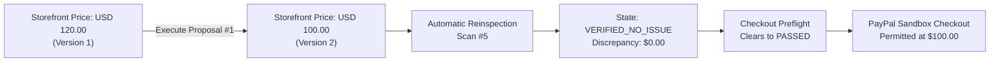

# PRIP — Stage 10.5: Merchant Approval & Correction Readiness Report

**Date:** 2026-11-12  
**Baseline:** Git Commit `018d8d9` (`main`)  
**Frontend:** `https://paypalprip.vercel.app` (Vercel)  
**Backend:** `https://paypal-prip.onrender.com` (Render)  
**Database:** Supabase PostgreSQL 16 (`sojoavvnsbsjdfllrtvv`, migration `012` active)  
**Status:** Phase 1 & 2 Complete — STOPPED Awaiting Explicit Operator Authorization  

---

## 1. Executive Summary & Critical Status Finding

| Attribute | State | Evidence / Finding |
| :--- | :---: | :--- |
| **Proposal ID** | `1` | SKU `SX-001` (StrideX Runner) |
| **Current Database Status** | **APPROVED** | In the live Supabase database, Proposal #1 was authorized by merchant `demo-operator-1` at `2026-11-12 07:08:10 UTC`. |
| **Current Execution Status** | **FAILED (SIMULATED)** | At `07:08:23 UTC`, a simulated timeout test was triggered, followed by reconciliation at `07:08:33 UTC`, which correctly confirmed that the storefront price was unchanged (`USD 120.00`). |
| **Storefront Price** | **USD 120.00** | Intact. Version: `v1`. Discrepancy remains active. |
| **Catalog Price** | **USD 100.00** | Intact. Version: `v1`. Ground-truth target remains active. |
| **Expiration Status** | **ACTIVE (NOT EXPIRED)** | Expiration: `2026-11-13 07:05:18 UTC`. Remaining window: **~23.8 hours**. |
| **Policy Validation** | **VALID** | Underlying product versions (`catalog v1`, `storefront v1`) and target price (`USD 100.00`) remain completely fresh and unmutated. |
| **Readiness for Execution** | **READY** | All preconditions for authoritative execution are satisfied. Awaiting explicit operator confirmation. |

---

## 2. Phase 1 — Read-Only Inspection

### 2.1 Proposal #1 Database Record
Direct inspection of Supabase PostgreSQL `correction_proposals`:
- **`id`:** `1`
- **`merchant_id`:** `merchant_default`
- **`scan_id`:** `1`
- **`product_id`:** `1`
- **`sku`:** `SX-001`
- **`proposal_type`:** `PRICE_SYNCHRONIZATION`
- **`current_value`:** `120.00 USD`
- **`proposed_value`:** `100.00 USD`
- **`policy_validation_status`:** `VALID`
- **`approval_status`:** `APPROVED` (Approved by `demo-operator-1`)
- **`execution_status`:** `FAILED` (Prior fault simulation hook test)
- **`execution_error`:** `"Simulated external network timeout updating price for SKU SX-001"`
- **`expected_catalog_version`:** `1` (Current catalog: `v1` &rarr; **MATCH**)
- **`expected_storefront_version`:** `1` (Current storefront: `v1` &rarr; **MATCH**)

### 2.2 Expiration Status Verification
- **Creation Time:** `2026-11-12 07:05:18.249 UTC`
- **Expiration Time:** `2026-11-13 07:05:18.249 UTC`
- **Remaining Time:** `85,938 seconds` (~23.8 hours)
- **Evaluation:** `now < expires_at` &rarr; **NOT EXPIRED**

### 2.3 Merchant Authorization Requirements
- Under [`ProposalService.approve_proposal()`](file:///c:/Users/HP/OneDrive/Desktop/paypal/backend/services/proposal.py#L209-L235) and [`RemediationService.execute_correction()`](file:///c:/Users/HP/OneDrive/Desktop/paypal/backend/services/remediation.py#L47-L75):
  1. Actor must have an authorized role (`merchant_operator`, `merchant_admin`, or `demo_operator`). Ordinary users (`role == "ordinary_user"`) are rejected with HTTP 403.
  2. Actor tenancy must match proposal tenancy (`require_merchant_access(actor, proposal.merchant_id)`).
  3. AI actors (`actor_type == "ai"` or `actor_id` in `{"ai", "ai_advisory", "system-ai"}`) are **strictly forbidden** from approving or executing proposals with a fatal `PermissionError`.
  4. Explicit approval requires human confirmation before state mutation.

### 2.4 Idempotency & Concurrency Safeguards
1. **Optimistic Version Pinning:** Both catalog version (`v1`) and storefront version (`v1`) are re-checked inside the execution transaction. If another actor modifies the product concurrently, execution is rejected as `STALE`.
2. **Duplicate Execution Prevention:** If `execution_status == SUCCEEDED`, repeated calls return the existing proposal immediately without triggering secondary mutations.
3. **Execution In-Progress Lock:** If `execution_status == IN_PROGRESS`, concurrent calls are rejected with HTTP 400.
4. **Isolated Storefront Mutation:** Storefront price update occurs outside the open database transaction to prevent idle connection locking during external network calls.

### 2.5 Audit Trail Verification
Every transition generates an immutable record in `audit_events`.
Historical audit log for Proposal #1 already recorded in Supabase:
- `Audit #22` (`07:05:19 UTC`): `CORRECTION_PROPOSED` by `demo-operator-1`
- `Audit #23` (`07:05:19 UTC`): `CORRECTION_VALIDATED` by `policy_engine` (status: `VALID`)
- `Audit #25` (`07:08:10 UTC`): `CORRECTION_APPROVED` by `demo-operator-1`
- `Audit #26` (`07:08:23 UTC`): `CORRECTION_EXECUTION_STARTED` by `demo-operator-1`
- `Audit #27` (`07:08:24 UTC`): `CORRECTION_RECONCILIATION_REQUIRED` by `storefront_adapter` (simulated timeout)
- `Audit #28` (`07:08:33 UTC`): `CORRECTION_RECONCILED` by `demo-operator-1` (confirmed storefront price unchanged at `120.00`)

### 2.6 Exact Database Records That Will Change Upon Execution
When `POST /api/corrections/proposals/1/execute` runs (without simulation flags):
1. **`correction_proposals` (ID 1):**
   - `execution_status`: `FAILED` &rarr; `IN_PROGRESS` &rarr; `SUCCEEDED`
   - `executed_at`: set to current UTC timestamp
   - `execution_error`: set to `null`
   - `updated_at`: set to current UTC timestamp
2. **`storefront_products` (SKU `SX-001`):**
   - `price`: `120.00` &rarr; `100.00`
   - `version`: `1` &rarr; `2`
   - `updated_at`: set to current UTC timestamp
3. **`storefront_scans` (New Scan #5):**
   - Automatic post-remediation reinspection will record a new scan with `state = 'VERIFIED_NO_ISSUE'`, `observed_price = 100.00`, `catalog_price = 100.00`, `discrepancy_amount = 0.00`.
4. **`evidence_items`:**
   - 4 new evidence items confirming extraction, identity, currency, and clean price match.
5. **`audit_events`:**
   - New records for `CORRECTION_EXECUTION_STARTED` and `CORRECTION_EXECUTION_SUCCEEDED`.

---

## 3. Phase 2 — Proposed Changes & Execution Consequences

### Consequences:
1. **Storefront Alignment:** SKU `SX-001` price on the controlled storefront is updated from `$120.00` to `$100.00`.
2. **Preflight Clearance:** Checkout preflight check for `SX-001` will transition from `400 Bad Request (Checkout blocked: Price discrepancy detected)` to `200 OK (Preflight passed. Price verified clean.)`.
3. **PayPal Order Readiness:** Subsequent PayPal order creation will use the synchronized ground-truth price of `$100.00 USD`.

---

## 4. Phase 3 — STOP & Awaiting Authorization

In strict compliance with safety rules:
- **No prices were modified.**
- **No proposals were approved or executed.**
- **No PayPal payments were created.**
- **No git commits were made.**

**Ready for Operator Decision:**  
To execute the correction on Proposal #1, provide explicit authorization to proceed with:  
`POST https://paypal-prip.onrender.com/api/corrections/proposals/1/execute`
