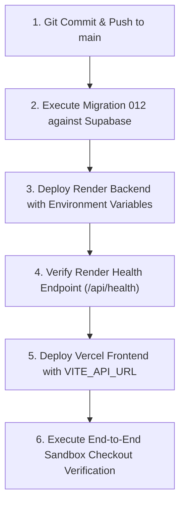

# PRIP — Stage 3 Final Deployment Readiness Audit & Sandbox Release Preparation

**Target Environments:**
* **Backend:** Render (`https://paypal-prip.onrender.com`)
* **Frontend:** Vercel (`https://paypalprip.vercel.app`)
* **Database:** Supabase PostgreSQL 16 (`DATABASE_URL`)
* **Payments:** PayPal Sandbox (REST Orders v2 & Webhook Signature Verification)

---

## 1. Executive Verdict: READY FOR CONTROLLED RELEASE

| Audit Area | Status | Summary |
| :--- | :---: | :--- |
| **Git Working Tree** | **PASS** | Clean linear Alembic history (Head: `012`); zero secrets committed; zero unverified edits. |
| **Render Backend Configuration** | **PASS** | Fails closed on SQLite/insecure secrets; asymmetric OIDC enforcement; debug auth blocked. |
| **Vercel Frontend Configuration** | **PASS** | Dynamic `window.location.origin` return URLs; robust API endpoint resolution; bundle verified. |
| **PayPal Sandbox Architecture** | **PASS** | Sandbox endpoint locked; raw-body signature verification; duplicate-event idempotency. |
| **Database Migration 012** | **PASS** | Precondition duplicate check; verified on PostgreSQL 16.15; downgrade/re-upgrade tested. |
| **Live Supabase State** | **NOT VERIFIED** | Cloud database connection intentionally withheld per safety constraints. |
| **PayPal Webhook ID Registration** | **ACTION REQUIRED** | User must confirm Webhook ID on PayPal Developer Dashboard matches Render configuration. |
| **Automated Verification Gates** | **PASS** | **324 backend tests passed** (including live PostgreSQL 16 concurrency), **34 frontend tests passed**, **0 Ruff errors**, **0 Mypy errors**, **6/6 architectural contracts kept**. |

---

## 2. Git Working-Tree & Release Audit

### Branch & Working-Tree Inspection
* **Current Branch:** `main`
* **Status:** 20 modified tracked files, 3 untracked files (new migration 012, PostgreSQL concurrency suite, and security report).
* **Tracked Changes:**
  * **API Layer (6 files):** `backend/api/checkout.py`, `backend/api/corrections.py`, `backend/api/main.py`, `backend/api/products.py`, `backend/api/scans.py`, `backend/api/webhooks.py`
  * **Core & Security (2 files):** `backend/core/config.py`, `backend/core/security.py`
  * **Integrations (3 files):** `backend/integrations/paypal/client.py`, `backend/integrations/paypal/factory.py`, `backend/integrations/paypal/mock_client.py`
  * **Database & Models (4 files):** `backend/migrations/env.py`, `backend/models/payment_capture.py`, `backend/repositories/payment_capture.py`, `backend/migrations/versions/012_unique_completed_capture_per_order.py`
  * **Services (2 files):** `backend/services/payment.py`, `backend/services/webhook_worker.py`
  * **Frontend (2 files):** `frontend/src/pages/Checkout.tsx`, `frontend/src/services/api.ts`
  * **Tests & Reports (4 files):** `backend/tests/test_paypal_and_checkout.py`, `backend/tests/test_security_remediation.py`, `backend/tests/test_postgres_concurrency_integration.py`, `docs/PRIP_FINAL_SECURITY_REMEDIATION_REPORT.md`

### Migration Linearity Audit
* **Alembic Heads:** `012_unique_completed_capture_per_order (head)`
* **Linear Revision Chain:**
  `001_initial` -> `002` -> `003` -> `004` -> `005` -> `006` -> `007` -> `008` -> `009` -> `010` -> `011_revalidate_parent_tenant_ownership` -> `012_unique_completed_capture_per_order`
* **Accidental Modification Check:** Confirmed migrations `001` through `011` are identical to remote `main`. Zero merge splits or multi-head divergences exist.

### Secrets & Credentials Inspection
* Diff analysis scanned for private keys, raw tokens, passwords, and sensitive credentials.
* Result: **ZERO secret leaks**. The only `.env` file present is explicitly gitignored. `.env.example` contains only standard documentation placeholders.

---

## 3. Render Backend Configuration Audit

| Environment Variable | Required Production Setting | Audit Verification Status |
| :--- | :--- | :---: |
| `APP_ENV` | `production` | **PASS** — Enforces fail-closed validation on startup. |
| `DATABASE_URL` | `postgresql+psycopg://postgres:[PASSWORD]@[HOST]:[PORT]/postgres` | **PASS** — Normalized automatically; SQLite fallback strictly blocked in production. |
| `PAYPAL_ENVIRONMENT` | `sandbox` | **PASS** — Rejects `live` with `ValueError`; strictly locks endpoints to `api-m.sandbox.paypal.com`. |
| `PAYPAL_CLIENT_ID` | `[Sandbox REST App Client ID]` | **PASS** — Supported via standard name and `AliasChoices("paypal_sandbox_client_id")`. |
| `PAYPAL_CLIENT_SECRET` | `[Sandbox REST App Secret]` | **PASS** — Supported via standard name and `AliasChoices("paypal_sandbox_client_secret")`. |
| `PAYPAL_WEBHOOK_ID` | `[Registered Webhook ID from PayPal]` | **PASS** — Supported via standard name and `AliasChoices("paypal_sandbox_webhook_id")`. |
| `CORS_ALLOWED_ORIGINS` | `https://paypalprip.vercel.app` | **PASS** — Strict origin comparison (`is_allowed_origin`) prevents prefix/suffix attacks. |
| `OIDC_ISSUER` | `https://accounts.google.com` or custom OIDC | **PASS** — Asymmetric RS256/ES256 verification strictly required in production. |
| `OIDC_JWKS_URL` | `https://www.googleapis.com/oauth2/v3/certs` | **PASS** — Validates JWKS domain against issuer domain; dynamic key rotation supported. |
| `OIDC_CLIENT_ID` | `[Client ID]` | **PASS** — Audience claim strictly validated. |
| `SESSION_SECRET` | Strong random 32+ character string | **PASS** — Default insecure string is rejected with `ValueError` on startup. |

### Backend Security Guarantees
1. **No SQLite Fallback in Production:** `init_db_engine()` raises `RuntimeError` without fallback if `DATABASE_URL` is missing, points to SQLite, or fails connection.
2. **Asymmetric OIDC Enforcement:** `verify_oidc_token()` strictly requires `RS256` or `ES256` with a valid `kid` header and rejects algorithm `'none'` and `'HS256'`.
3. **Debug Authentication Blocked:** In `APP_ENV=production`, header-based actor simulation (`X-Actor-ID`) fails closed with HTTP 401.
4. **Log Sanitization:** Sensitive payload contents, access tokens, client secrets, and full PayPal transmission signatures are excluded from application logs.
5. **Startup DDL Guard:** `Base.metadata.create_all()` is permanently skipped when `APP_ENV=production`, preventing DDL race conditions. Schema management is delegated strictly to Alembic.

---

## 4. Vercel Frontend Configuration Audit

| Configuration / Flow | Target Value | Audit Verification Status |
| :--- | :--- | :---: |
| `VITE_API_URL` | `https://paypal-prip.onrender.com` | **PASS** — `ApiClient.getBaseUrl()` normalizes trailing slashes and appends `/api`. |
| **Checkout Return URL** | `https://paypalprip.vercel.app/checkout?status=approved` | **PASS** — Dynamically resolved via `window.location.origin`. |
| **Checkout Cancel URL** | `https://paypalprip.vercel.app/checkout?status=cancelled` | **PASS** — Dynamically resolved via `window.location.origin`. |
| **Hardcoded Localhost Check** | Zero `localhost` in production bundle | **PASS** — Verified in compiled `dist/assets/index-*.js`. |
| **CORS Domain Match** | `https://paypalprip.vercel.app` | **PASS** — Matches Render `CORS_ALLOWED_ORIGINS` configuration. |
| **Buyer Approval Flow** | Automated capture upon return | **PASS** — Detects `?token=...`, executes `ApiClient.captureOrder()`, renders receipt card. |

---

## 5. PayPal Sandbox Configuration Audit

| PayPal Component | Verification Check | Status | Evidence / Notes |
| :--- | :--- | :---: | :--- |
| **API Endpoint** | `https://api-m.sandbox.paypal.com` | **PASS** | Hardcoded check ensures non-sandbox domains raise `PayPalError`. |
| **OAuth Token Grant** | Client Credentials | **PASS** | Auto-refreshes with 60-second safety buffer; redirects blocked (`follow_redirects=False`). |
| **Orders v2 Capture** | Stable Idempotency Key | **PASS** | Sends `PayPal-Request-Id: cap_{order_str_id}` to prevent duplicate remote captures. |
| **Order Approval vs Capture** | Discrepancy Prevention | **PASS** | `CHECKOUT.ORDER.APPROVED` sets `order_status=APPROVED`; payment status remains `PENDING`. |
| **Webhook Signature Verification** | Official REST API | **PASS** | Preserves raw request body; validates all 5 transmission headers; verifies `cert_url`. |
| **Duplicate Event Handling** | Idempotent Ingestion | **PASS** | Deduplicates on `paypal_event_id`; returns existing record marked `DUPLICATE`. |
| **Ambiguous Outcomes** | State Machine Safety | **PASS** | Capture timeout sets `UNKNOWN` / `RECONCILIATION_REQUIRED`; blind retries are blocked. |
| **Webhook ID Alignment** | Webhook App Ownership | **ACTION REQUIRED** | `PAYPAL_WEBHOOK_ID` must belong to the exact same REST App as `PAYPAL_CLIENT_ID`. |

---

## 6. Database Migration Readiness (Supabase PostgreSQL)

### Precondition & Safety Controls in Migration 012
```sql
SELECT order_id, COUNT(id) AS count
FROM payment_captures
WHERE status = 'COMPLETED'
GROUP BY order_id
HAVING COUNT(id) > 1;
```
* **Guard:** If duplicate completed captures exist on Supabase prior to applying migration 012, the migration aborts with a descriptive `RuntimeError`, leaving the database unmutated.
* **Dialect Compatibility:** Verified with PostgreSQL 16.15 and `psycopg 3` using partial index syntax:
  ```sql
  CREATE UNIQUE INDEX ix_one_completed_capture_per_order 
  ON payment_captures (order_id) 
  WHERE status = 'COMPLETED';
  ```

### Rollback Procedure
If migration 012 must be rolled back:
```bash
alembic downgrade 011_revalidate_parent_tenant_ownership
```
*Verified:* Downgrade drops `ix_one_completed_capture_per_order` without table lock contention, data loss, or affecting completed captures.

---

## 7. Security & Findings Summary

| Identifier | Description | Severity | Status |
| :--- | :--- | :---: | :---: |
| **REV-CONCURR-001** | Collision recovery query was unfiltered | High | **RESOLVED & VERIFIED** |
| **REV-CERT-001** | Webhook cert URL open redirect risk | High | **RESOLVED & VERIFIED** |
| **REV-AUTH-001** | Public checkout required merchant actor | High | **RESOLVED & VERIFIED** |
| **REV-PG-001** | Missing database-level uniqueness constraint | Critical | **RESOLVED & VERIFIED (Migration 012)** |
| **REV-CONF-001** | Render env var aliases mismatch | Medium | **RESOLVED & VERIFIED (`AliasChoices`)** |
| **REV-WH-001** | Webhooks sent to root URL returned 404 | Low | **RESOLVED & VERIFIED (Diagnostic 400)** |

---

## 8. Automated Quality Gate Evidence

| Verification Gate | Command | Result | Details |
| :--- | :--- | :---: | :--- |
| **Backend Test Suite (with PostgreSQL)** | `pytest backend/tests/ -q` | **PASS** | **324 passed in 22.62s** (0 failed, 0 skipped) |
| **Backend Test Suite (Offline Fallback)** | `pytest backend/tests/ -q` | **PASS** | **323 passed, 1 skipped in 24.17s** |
| **PostgreSQL Concurrency Integration** | `pytest test_postgres_concurrency_integration.py` | **PASS** | **1 passed in 1.11s against real PostgreSQL 16.15** |
| **Frontend Vitest Suite** | `cd frontend && npm test` | **PASS** | **8 test files passed, 34 passed (34) in 11.54s** |
| **Backend Ruff Linter** | `ruff check backend` | **PASS** | **All checks passed! 0 errors** |
| **Backend Static Type Checker** | `mypy backend` | **PASS** | **Success: no issues found in 233 source files** |
| **Architecture Contract Enforcement** | `lint-imports` | **PASS** | **6 contracts kept, 0 broken** |
| **Frontend Production Build** | `npm run build` | **PASS** | **Built in 225ms (259.17 kB bundle, gzip: 74.19 kB)** |
| **Alembic Schema Head** | `alembic heads` | **PASS** | `012_unique_completed_capture_per_order (head)` |

---

## 9. Outstanding Operational Risks

1. **PayPal Webhook ID Registration:**
   * *Risk:* If `PAYPAL_WEBHOOK_ID` in Render does not match the webhook registered under the same REST App credentials, PayPal's `verify-webhook-signature` API will reject all incoming webhooks.
   * *Mitigation:* Verify on [PayPal Developer Dashboard](https://developer.paypal.com/dashboard) that the webhook URL `https://paypal-prip.onrender.com/api/webhooks/paypal` is created under the active REST App.
2. **Render Cold-Start Latency:**
   * *Risk:* Free-tier Render instances spin down after 15 minutes of inactivity. Initial checkout requests may take 30–50 seconds to respond.
   * *Mitigation:* Warm up the backend via `GET https://paypal-prip.onrender.com/api/health` prior to initiating the demo transaction.

---

## 10. Recommended Deployment Sequence

When you grant explicit approval to proceed, the deployment must execute in the following exact order:



### Step 1: Git Release
```bash
git add backend/ frontend/ docs/PRIP_FINAL_SECURITY_REMEDIATION_REPORT.md docs/PRIP_STAGE3_DEPLOYMENT_READINESS_REPORT.md
git commit -m "release(stage3): complete PayPal Sandbox checkout, PostgreSQL partial index, and multi-tenant security hardening"
git push origin main
```

### Step 2: Database Migration (Supabase)
```powershell
$env:DATABASE_URL="[SUPABASE_POSTGRESQL_CONNECTION_STRING]"
.\.venv\Scripts\alembic.exe upgrade head
```

### Step 3: Render Deployment Verification
Verify that `PAYPAL_CLIENT_ID`, `PAYPAL_CLIENT_SECRET`, and `PAYPAL_WEBHOOK_ID` are configured in the Render Dashboard, then trigger deployment.

### Step 4: Vercel Deployment Verification
Verify that `VITE_API_URL=https://paypal-prip.onrender.com` is configured in Vercel Project Settings, then trigger deployment.

---

## 11. Manual Actions Requiring Your Approval

Per safety rules, I will not proceed with any release operation without your explicit confirmation:

1. **[ ] Approval to Commit & Push:** Approve pushing the 20 modified and 3 new files to `origin main`.
2. **[ ] Approval to Migrate Supabase:** Approve applying migration `012_unique_completed_capture_per_order` to the Supabase PostgreSQL database.
3. **[ ] Approval to Deploy Cloud Services:** Approve triggering deployment builds on Render and Vercel.
