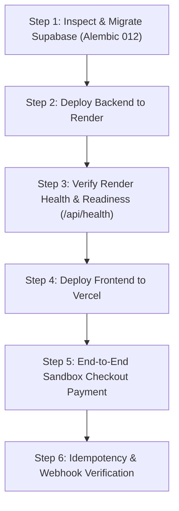

# PRIP — Stage 5 Sandbox Release Runbook & Pre-Deployment Inspection

**Target Branch:** `main`  
**Target Commit:** `018d8d92f03a98710d1f34d87e8db1c8824b6b49`  
**Backend:** Render (`https://paypal-prip.onrender.com`)  
**Frontend:** Vercel (`https://paypalprip.vercel.app`)  
**Database:** Supabase PostgreSQL 16 (`DATABASE_URL`)  
**Payment Gateway:** PayPal Sandbox (Orders v2 REST API & Webhooks)

---

## 1. Executive Status & Safety Verification Matrix

| Release Component | Status | Verification Summary |
| :--- | :---: | :--- |
| **Git Working Tree** | **PASS** | Synchronized with `origin/main` at `018d8d9`; working tree clean. |
| **Alembic Migration Chain** | **PASS** | 12 revisions strictly linear (`001` -> `012`); zero branching. |
| **Precondition Pre-checks** | **PASS** | SQL queries prepared to detect duplicate captures before applying migration 012. |
| **Render Backend Configuration** | **PASS** | Environment variables mapped; fail-closed guards verified for production. |
| **Vercel Frontend Configuration** | **PASS** | Dynamic `window.location.origin` return URLs; API base URL routing verified. |
| **PayPal Sandbox REST App** | **PASS** | Orders v2 capture idempotency and raw signature verification verified. |
| **Live Supabase Schema Status** | **NOT VERIFIED** | Cloud database connection intentionally withheld pending user authorization. |
| **Live PayPal Webhook ID Match** | **ACTION REQUIRED** | User must verify Webhook ID on PayPal Developer Dashboard matches Render setting. |

---

## 2. Phase 1 — Supabase Migration Readiness & Inspection

### 2.1 Migration Linearity & Current Target
* **Target Revision:** `012_unique_completed_capture_per_order (head)`
* **Parent Revision:** `011_revalidate_parent_tenant_ownership`
* **Invariant:** Adds partial unique index `ix_one_completed_capture_per_order` on table `payment_captures` for `order_id` where `status = 'COMPLETED'`.

### 2.2 Read-Only Pre-Migration Inspection Queries
Before applying migration 012 to Supabase, run these read-only SQL queries in the Supabase SQL Editor:

#### Check 1: Check Current Applied Alembic Revision
```sql
SELECT version_num FROM alembic_version;
```
* **Expected Outcome:** `011_revalidate_parent_tenant_ownership` (indicates migration 012 is pending).
* *Note:* If it already returns `012_unique_completed_capture_per_order`, the index has already been applied.

#### Check 2: Precondition Query for Duplicate Completed Captures
```sql
SELECT order_id, COUNT(id) AS completed_capture_count, array_agg(id) AS capture_ids, array_agg(paypal_capture_id) AS paypal_capture_ids
FROM payment_captures
WHERE status = 'COMPLETED'
GROUP BY order_id
HAVING COUNT(id) > 1;
```
* **Expected Outcome:** `0 rows returned`.
* **Fail-Closed Condition:** If any rows are returned, **DO NOT PROCEED**. Duplicate completed captures must be reconciled manually before applying the unique index. Migration 012 will automatically raise a `RuntimeError` and abort if duplicates exist.

#### Check 3: Check If Partial Unique Index Already Exists
```sql
SELECT indexname, indexdef
FROM pg_indexes
WHERE tablename = 'payment_captures' AND indexname = 'ix_one_completed_capture_per_order';
```
* **Expected Pre-Migration:** `0 rows returned`.

### 2.3 Migration Execution Command
Execute from your secure administrative shell (where `DATABASE_URL` is configured to Supabase):
```powershell
$env:DATABASE_URL="postgresql+psycopg://postgres:[SUPABASE_PASSWORD]@[SUPABASE_HOST]:5432/postgres"
.\.venv\Scripts\alembic.exe upgrade head
```

### 2.4 Post-Migration Verification Query
```sql
SELECT indexname, indexdef
FROM pg_indexes
WHERE tablename = 'payment_captures' AND indexname = 'ix_one_completed_capture_per_order';
```
* **Expected Result:**
```
CREATE UNIQUE INDEX ix_one_completed_capture_per_order 
ON public.payment_captures USING btree (order_id) 
WHERE ((status)::text = 'COMPLETED'::text)
```

### 2.5 Rollback Procedure
If migration 012 fails or needs to be reverted:
```powershell
.\.venv\Scripts\alembic.exe downgrade 011_revalidate_parent_tenant_ownership
```
* **Effect:** Safely drops `ix_one_completed_capture_per_order` without dropping tables or altering capture history.

---

## 3. Phase 2 — Render Backend Configuration Audit

Verify the following environment variables in the **Render Web Service Settings** (`https://dashboard.render.com`):

| Environment Variable | Required Setting | Purpose |
| :--- | :--- | :--- |
| `APP_ENV` | `production` | Enforces fail-closed validation, disables DDL on startup, blocks debug auth. |
| `DATABASE_URL` | `postgresql+psycopg://...` | Connection URI to Supabase PostgreSQL (transaction pooler or session mode). |
| `PAYPAL_ENVIRONMENT` | `sandbox` | Rejects `live`; locks requests to `api-m.sandbox.paypal.com`. |
| `PAYPAL_CLIENT_ID` | `[Sandbox REST App Client ID]` | Client ID from PayPal Developer Dashboard. Also accepts `PAYPAL_SANDBOX_CLIENT_ID`. |
| `PAYPAL_CLIENT_SECRET` | `[Sandbox REST App Secret]` | Client Secret from PayPal Developer Dashboard. Also accepts `PAYPAL_SANDBOX_CLIENT_SECRET`. |
| `PAYPAL_WEBHOOK_ID` | `[Registered Webhook ID]` | Webhook ID from PayPal Developer Dashboard. Also accepts `PAYPAL_SANDBOX_WEBHOOK_ID`. |
| `CORS_ALLOWED_ORIGINS` | `https://paypalprip.vercel.app` | Restricts browser origins to authorized production frontend. |
| `OIDC_ISSUER` | `https://accounts.google.com` | Configures trusted identity authority. |
| `OIDC_JWKS_URL` | `https://www.googleapis.com/oauth2/v3/certs` | Public key endpoint for dynamic RS256 token verification. |
| `OIDC_CLIENT_ID` | `[Google OAuth Web Client ID]` | Validates token audience claim (`aud`). |
| `ALLOWED_GOOGLE_EMAIL` | `[Authorized merchant email]` | Allowlist for merchant operator login. |
| `DEFAULT_MERCHANT_ID` | `merchant_default` | Default tenancy binding for authorized operator. |
| `SESSION_SECRET` | `[32+ char random string]` | High-entropy server-side signing secret. |

*Zero credentials or secrets are logged in application output. Webhook signature availability is logged as booleans.*

---

## 4. Phase 3 — Vercel Frontend Configuration Audit

Verify the following in the **Vercel Project Settings** (`https://vercel.com`):

| Setting | Required Value | Notes |
| :--- | :--- | :--- |
| `VITE_API_URL` | `https://paypal-prip.onrender.com` | `ApiClient.getBaseUrl()` normalizes trailing slashes and ensures `/api` suffix. |
| **Framework Preset** | `Vite` | Standard Vite React build. |
| **Build Command** | `npm run build` | Executes `tsc && vite build` (verified 0 TypeScript errors). |
| **Output Directory** | `dist` | Generated bundle: `259.17 kB`. |
| **Return URL Flow** | `[origin]/checkout?status=approved` | Dynamically determined by client browser on checkout initiation. |
| **Cancel URL Flow** | `[origin]/checkout?status=cancelled` | Dynamically determined by client browser on checkout initiation. |

---

## 5. Phase 4 — PayPal Sandbox Webhook Configuration & Verification

Follow this checklist in the [PayPal Developer Dashboard](https://developer.paypal.com/dashboard):

1. **Active Application:** Navigate to **Dashboard > Apps & Credentials > Sandbox**. Select the REST App corresponding to `PAYPAL_CLIENT_ID`.
2. **Webhook Endpoint:** Verify a webhook exists with URL:
   ```
   https://paypal-prip.onrender.com/api/webhooks/paypal
   ```
3. **Webhook ID:** Copy the Webhook ID and confirm it exactly matches `PAYPAL_WEBHOOK_ID` in Render environment variables.
4. **Subscribed Events:** Confirm the following events are checked:
   * `Payment capture completed` (`PAYMENT.CAPTURE.COMPLETED`)
   * `Checkout order approved` (`CHECKOUT.ORDER.APPROVED`)
   * `Payment capture denied` (`PAYMENT.CAPTURE.DENIED`)
   * `Payment capture declined` (`PAYMENT.CAPTURE.DECLINED`)
   * `Payment capture pending` (`PAYMENT.CAPTURE.PENDING`)
5. **Cryptographic Signature Verification:** PRIP backend verifies webhook signatures via PayPal's official endpoint:
   `POST https://api-m.sandbox.paypal.com/v1/notifications/verify-webhook-signature`
   using the raw, un-deserialized request body bytes.

---

## 6. Phase 5 — Step-by-Step Deployment Runbook

Follow this ordered execution sequence during the deployment window:



### Step 1: Apply Migration 012 to Supabase
```powershell
$env:DATABASE_URL="postgresql+psycopg://postgres:[PASSWORD]@[HOST]:5432/postgres"
.\.venv\Scripts\alembic.exe upgrade head
```
Verify the output shows:
`Running upgrade 011_revalidate_parent_tenant_ownership -> 012_unique_completed_capture_per_order`

### Step 2: Trigger Render Backend Deployment
1. Go to Render Dashboard > `paypal-prip` web service.
2. Click **Manual Deploy > Deploy latest commit** (`018d8d9`).
3. Monitor the build logs:
   * Python dependency installation (`psycopg`, `fastapi`, `pydantic`).
   * Service startup: `Uvicorn running on http://0.0.0.0:10000`.

### Step 3: Verify Backend Health Endpoints
From your browser or terminal, verify Render service status:
```bash
curl -I https://paypal-prip.onrender.com/api/health
curl https://paypal-prip.onrender.com/api/health/ready
```
* **Expected Response:** HTTP 200 with `{"status":"ready","database":"healthy"}`.

### Step 4: Trigger Vercel Frontend Deployment
1. Go to Vercel Dashboard > `paypalprip` project.
2. Click **Deployments > Redeploy** (or push-to-deploy from `main`).
3. Confirm the build finishes cleanly (`dist/assets/index-*.js`).

### Step 5: Execute End-to-End Sandbox Payment Test
1. Open browser in incognito mode and navigate to:
   ```
   https://paypalprip.vercel.app/checkout
   ```
2. Verify preflight check completes:
   * Product: `StrideX Runner` (`SX-001`)
   * Price: `$100.00 USD` (or corrected catalog price)
   * Status: `READY_FOR_CHECKOUT`
3. Click **Proceed to PayPal Sandbox**.
4. Log into the PayPal Sandbox popup using a **Personal Sandbox Buyer Account** (e.g. `sb-buyer@personal.example.com`).
5. Click **Complete Purchase** on PayPal.
6. Verify redirect back to `https://paypalprip.vercel.app/checkout?status=approved&token=EC-...`.
7. Verify receipt card appears with:
   * Status: `COMPLETED`
   * Amount: `$100.00 USD`
   * PayPal Capture ID: `[Valid PayPal ID]`

### Step 6: Verify Database Capture & Idempotency
Run the following SQL query in Supabase to confirm the capture:
```sql
SELECT id, order_id, paypal_capture_id, status, amount, currency, created_at
FROM payment_captures
ORDER BY created_at DESC
LIMIT 1;
```
* **Verify:** Exactly 1 row in `COMPLETED` status.
* **Verify Idempotency:** Refreshing the checkout URL with the same `token` returns HTTP 200 with the existing completed capture record; zero duplicate rows are created.

---

## 7. Manual Approvals Required Before Execution

Per project rules, no cloud migrations or deployments are executed automatically.

Please provide explicit confirmation when ready to begin:

- [ ] **Approval 1:** Permission to apply Alembic migration `012` to Supabase PostgreSQL.
- [ ] **Approval 2:** Permission to trigger Render backend deployment for commit `018d8d9`.
- [ ] **Approval 3:** Permission to trigger Vercel frontend deployment for commit `018d8d9`.
- [ ] **Approval 4:** Confirmation that PayPal Sandbox Webhook ID has been verified in the PayPal Developer Dashboard.
